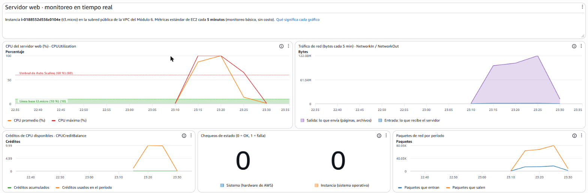

# Servidor-Web-Monitoreo-Dashboard · Amazon CloudWatch

Panel de control en tiempo real para el servidor web EC2 que vive en la VPC del Módulo 6. Muestra qué tan exigida está la instancia, cuánto tráfico mueve y si está sana, para tomar decisiones **basadas en datos y no en suposiciones**.

Autora: **María Cecilia Alegre** · Curso AWS Cloud Practitioner



## Resultado de la prueba real

La prueba se hizo el 4 de noviembre de 2026, entre las 23:10 y las 23:35 UTC (20:10 a 20:35 en Argentina), sobre la instancia `i-0188552d556c0104e`, creada con la plantilla de este repositorio. La captura muestra lo siguiente:

| Qué hice | Qué mostró el dashboard | Interpretación |
|---|---|---|
| Lancé 2 procesos de CPU por 10 minutos (`scripts/subir_cpu.sh`) | **CPU** al 88-100 % entre las 23:15 y las 23:25, y vuelta a ~0 % a las 23:30 | La instancia estuvo muy por encima del umbral de 60 %. En producción, el Auto Scaling habría agregado instancias. |
| Descargué el archivo de prueba 15 veces (300 MB) | **NetworkOut** de ~97, ~103 y ~120 MB por período; **NetworkIn** casi en 0 | Coincide con lo esperado: el servidor envía mucho (los archivos) y recibe poco (solo los pedidos). La suma da unos 315 MB, igual a lo descargado. |
| Las mismas descargas | **Paquetes que salen**: hasta ~80 mil por período, unas 5 veces los que entran | Las descargas grandes generan muchos paquetes de salida, y por cada tanda de paquetes de salida el cliente devuelve un acuse de recibo. |
| — | **Créditos usados**: ~10 por período · **Balance**: 0 | 2 vCPU al 100 % durante 5 minutos consumen 10 créditos (1 crédito = 1 vCPU al 100 % durante 1 minuto). La instancia era nueva y no tenía créditos acumulados: en modo *unlimited* (el valor por defecto de las t3), el excedente se cobra aparte, unos centavos en esta prueba. |
| — | **Chequeos de estado**: 0 y 0 | La instancia y el hardware de AWS estuvieron sanos durante toda la prueba, incluso con la CPU al 100 %. |

La definición que exporté de la consola (*Acciones → Ver o editar origen*) está en `dashboard/exportado-desde-aws.json`. Es idéntica a la plantilla del repositorio, con el ID real de la instancia.

## Contenido del repositorio

| Ruta | Qué contiene |
|---|---|
| `dashboard/Servidor-Web-Monitoreo-Dashboard.json` | **Definición del dashboard** como plantilla (el mismo formato que exporta la consola en *Acciones → Ver o editar origen*) |
| `dashboard/exportado-desde-aws.json` | La definición **exportada del dashboard real**, con el ID de la instancia de la prueba |
| `infraestructura/servidor-y-dashboard.yaml` | CloudFormation: VPC, subred pública, EC2 con Apache y el dashboard, en un solo paso |
| `scripts/crear_dashboard.sh` | Crea el dashboard para una instancia que ya existe (verifica antes el ID y su VPC) |
| `scripts/exportar_dashboard.sh` | Descarga la definición actual del dashboard desde AWS |
| `scripts/generar_trafico.sh` / `.ps1` | Descarga un archivo de 20 MB varias veces para mover las métricas de red |
| `scripts/subir_cpu.sh` | Lleva la CPU al 100 % durante 10 minutos (se ejecuta dentro de la instancia) |
| `capturas/` | Capturas del dashboard con datos reales |

## Qué muestra cada widget

| # | Widget | Tipo | Métrica (estadística) | Qué significa | Cómo leerlo |
|---|---|---|---|---|---|
| 1 | **CPU del servidor web (%)** | Línea | `CPUUtilization` (promedio y máximo) | Porcentaje de la capacidad de procesamiento que usa la instancia. Mide **qué tan "estresado"** está el servidor. | Si queda **más de 60 %** durante varios minutos (línea roja), hacen falta más instancias: es el umbral del Auto Scaling de la Pre-entrega 3. Si está siempre cerca de 0 %, la instancia está sobredimensionada. |
| 2 | **Tráfico de red** | Área apilada | `NetworkIn` y `NetworkOut` (suma) | Bytes que **recibe** (pedidos de los visitantes) y que **envía** (páginas y archivos) la instancia en cada período de 5 minutos. | En un servidor web, la salida suele ser mucho mayor que la entrada. Al estar apiladas, la altura total es todo el tráfico. Para pasarlo a velocidad: `bytes × 8 ÷ 300 s` = bits por segundo. |
| 3 | **Créditos de CPU** | Línea | `CPUCreditBalance` y `CPUCreditUsage` | La `t3.micro` es una instancia **con ráfagas**: tiene una línea base de 10 % de CPU y junta créditos cuando usa menos. Los gasta cuando necesita más. | Si el balance baja hasta cero de forma sostenida, la carga es mayor que la línea base: conviene una instancia más grande o escalar horizontalmente. |
| 4 | **Chequeos de estado** | Número | `StatusCheckFailed_System` y `_Instance` (máximo) | **0 = OK, 1 = falla.** *Sistema*: problema del hardware o de la red de AWS. *Instancia*: problema del sistema operativo (por ejemplo, se quedó sin memoria). | Cualquier 1 es una alerta. Una falla de *sistema* se suele resolver deteniendo e iniciando la instancia (pasa a otro host). Una de *instancia* hay que revisarla en el servidor. |
| 5 | **Paquetes de red** | Línea | `NetworkPacketsIn` y `NetworkPacketsOut` (suma) | Cantidad de paquetes, no de bytes. | Muchos paquetes con pocos bytes pueden indicar muchas conexiones chicas (o un ataque). Pocos paquetes con muchos bytes son descargas grandes. |

Arriba de todo hay un **widget de texto** que identifica la instancia y enlaza a esta explicación.

### Cosas importantes para interpretar los datos

- **Monitoreo básico, cada 5 minutos.** Las métricas de EC2 se publican cada 5 minutos sin costo. Por eso los cambios aparecen en el dashboard **5 a 10 minutos después**. Con el monitoreo detallado (`Monitoring: true`) llegan cada 1 minuto, pero tiene costo.
- **La memoria RAM y el disco no aparecen.** EC2 mide la instancia "desde afuera", con lo que ve el hipervisor. Para ver memoria y uso del disco hay que instalar el **agente de CloudWatch** dentro de la instancia.
- **Métricas vacías:** si la instancia está detenida, no se publican datos y el gráfico queda en blanco.
- **Instancia correcta:** el script `crear_dashboard.sh` muestra el ID, el estado, la VPC y el nombre de la instancia antes de crear el dashboard. Así se evita graficar la instancia equivocada.

## Cómo crearlo

### Opción A · Consola (pasos del ejercicio)

1. **CloudWatch → Dashboards → Create dashboard**, con el nombre `Servidor-Web-Monitoreo-Dashboard`.
2. **Widget de línea:** *EC2 → Per-Instance Metrics →* buscar la instancia y marcar `CPUUtilization`.
3. **Widget de área apilada:** misma instancia, marcar `NetworkIn` y `NetworkOut`.
4. En cada widget, editar el título y las etiquetas (pestaña *Graphed metrics → Label*).
5. **Actions → View/edit source** para copiar el JSON y guardarlo en `dashboard/`.

Para cargar directamente el dashboard completo de este repositorio: *Actions → View/edit source →* pegar el JSON reemplazando `i-REEMPLAZAR_POR_TU_INSTANCIA` por el ID real.

### Opción B · Línea de comandos (instancia existente)

```bash
./scripts/crear_dashboard.sh i-0abc1234567890def us-east-1
```

### Opción C · Todo junto con CloudFormation (servidor + dashboard)

```bash
aws cloudformation deploy \
  --template-file infraestructura/servidor-y-dashboard.yaml \
  --stack-name monitoreo-servidor-web \
  --capabilities CAPABILITY_IAM
```

Las salidas del stack dan la URL del servidor y la del dashboard.

## Simular actividad

1. **Tráfico de red**, desde tu computadora:
   ```bash
   ./scripts/generar_trafico.sh http://<UrlServidor> 30          # Linux, macOS o Git Bash
   .\scripts\generar_trafico.ps1 -Url http://<UrlServidor> -Veces 30   # Windows
   ```
   Treinta descargas de 20 MB suman unos 600 MB de `NetworkOut`.
2. **CPU**, desde **EC2 → Instancias → Conectar → Session Manager** (no hace falta abrir SSH):
   ```bash
   curl -s https://raw.githubusercontent.com/MaCecilia92/cloudwatch-dashboard-monitoreo/main/scripts/subir_cpu.sh | bash
   ```
   La CPU sube al 100 % por 10 minutos y se detiene sola. Mientras tanto, el balance de créditos baja.
3. Esperar de 5 a 10 minutos y actualizar el dashboard. Se puede elegir el rango **1h** y la actualización automática (botón ↻) cada 1 minuto.

## Costos y limpieza

- **Dashboard:** la capa gratuita incluye 3 dashboards personalizados de hasta 50 métricas cada uno por mes. Este usa 10 métricas.
- **Métricas de EC2 (monitoreo básico):** sin costo.
- **EC2 t3.micro:** cobra por hora mientras está en ejecución.

Al terminar:

```bash
aws cloudformation delete-stack --stack-name monitoreo-servidor-web
```

Ese comando borra la VPC, la instancia y el dashboard.
